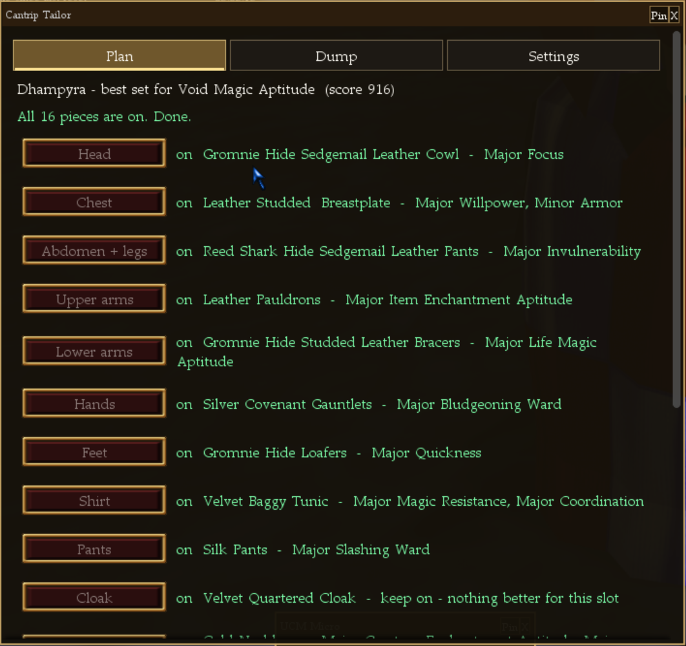
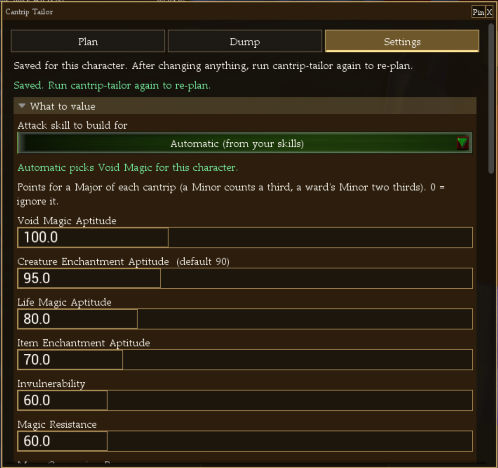
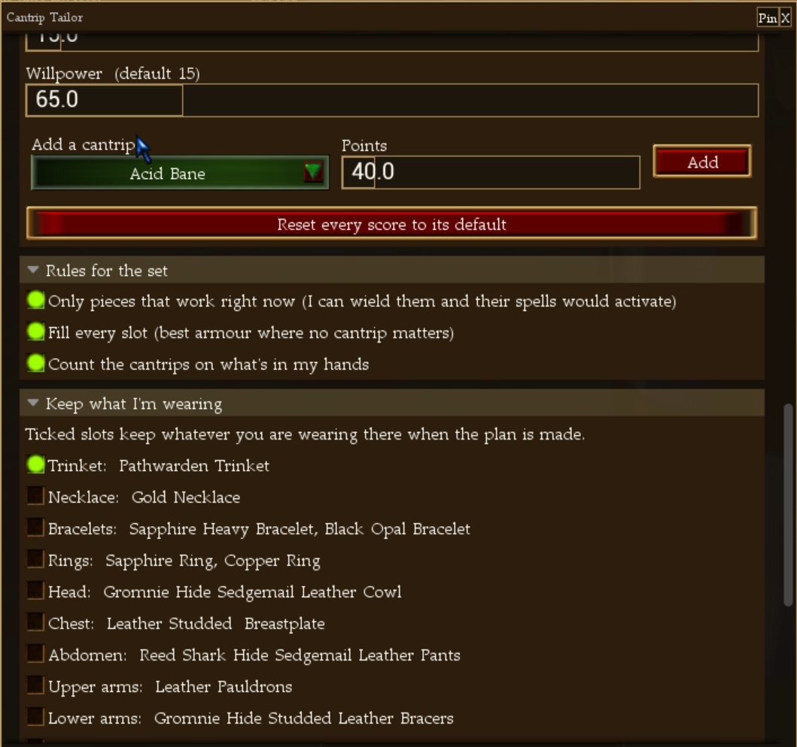
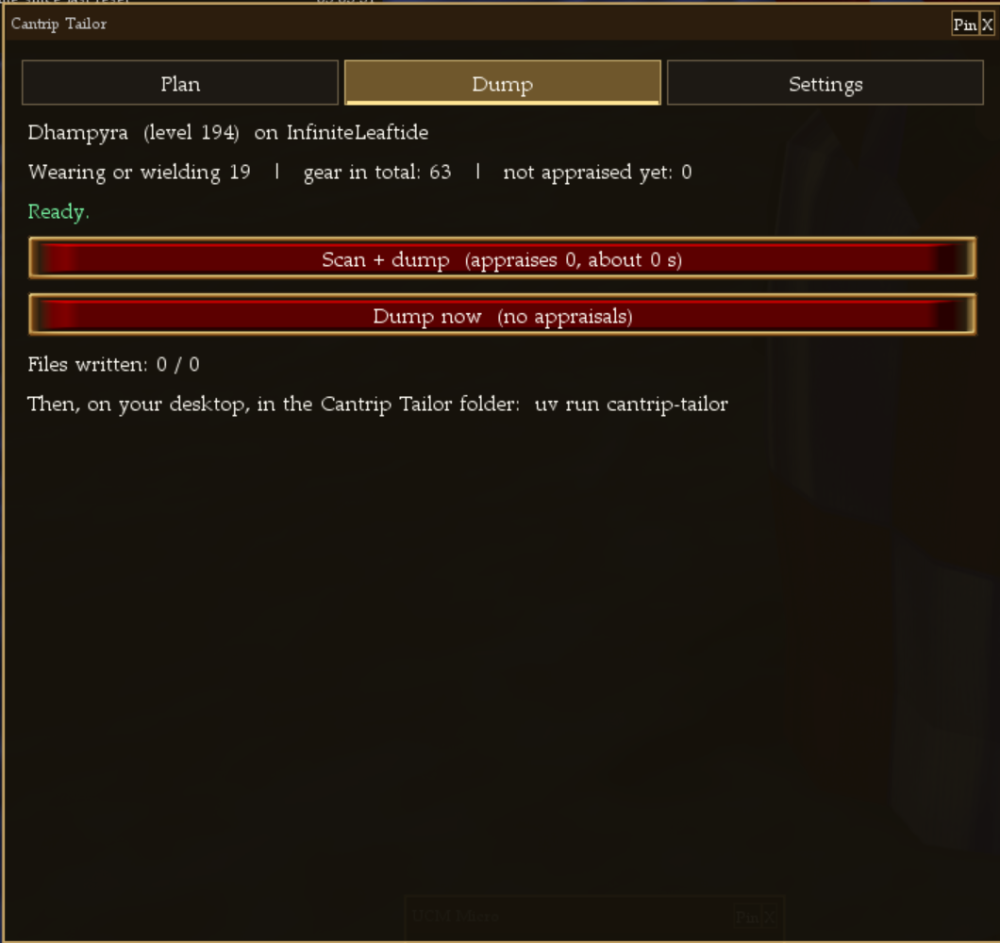
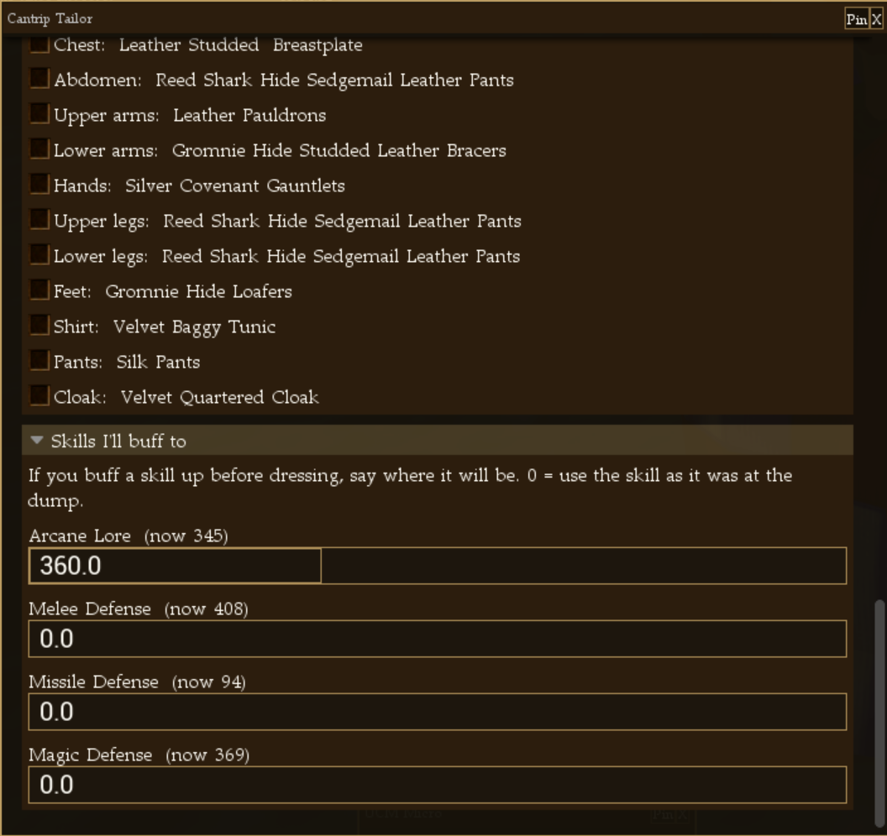

# Cantrip Tailor

**Which pieces of looted armour, worn together, give you the best cantrips?**

A pack full of loot, every piece with two or three cantrips on it, and
seventeen places to wear things. Working out the best combination by eye in
the inventory panel is slow, and the answer changes with every new drop.
Cantrip Tailor does it for you - for the AC:Unreal Asheron's Call client -
and then points at each piece in your packs so you can put the set on.

It comes in two halves:

| | what it is | what it does |
|---|---|---|
| **In game** | a Lua plugin for AC:Unreal | Holds your settings (what you value, what to keep on). Dumps what you're wearing and every wearable in your packs to a file. Later, shows the chosen set with a button per piece that highlights it in your inventory. |
| **On your desktop** | a small Python command, `cantrip-tailor` | Reads the dump and your settings, works out the best set (exactly - it's a solver, not a guess) and writes the plan the plugin shows. |

The working-out happens outside the game because a plugin's sandbox is too
small for it. Nothing is sent anywhere: both halves only read and write files
in the plugin's own folder on your PC.

> **Status:** new. Built and used on one ACE-based server (Infinite Leaftide)
> with the November 2026 client. It should work anywhere the client does, but
> you may be the first to try it on your server - please report what you find.

---

## What you get

```
Options: attack automatic; usable only; fill slots; lock trinket
Mage - level 180 - best set for Void Magic Aptitude with every slot filled
Dump taken 4 minutes ago.
85 wearable pieces in the dump.  Score 823.

WEAR   (* = this piece supplies the cantrip in the plan, (...) = wanted but outdone by another piece)
  Head        Leather Cowl  [main pack]  (Minor Invulnerability), *Major Focus   <AL 269; activate: Arcane Lore 338>
  Chest       Alduressa Coat  [pack 2]  *Major Item Enchantment Aptitude   <AL 281; activate: Arcane Lore 137, Melee Defense 260>
  Abdomen     Lorica Leggings  [main pack]  *Major Armor   <AL 246; activate: Arcane Lore 149, Melee Defense 292>
  Upper arms  (same piece: Alduressa Coat)
  ...
  Trinket     Pathwarden Trinket  [worn]  no cantrips   <LOCKED>
  Ring 1      Copper Ring  [main pack]  *Major Acid Ward, *Minor Frost Ward   <activate: Arcane Lore 296>

COVERAGE, in priority order
  Void Magic Aptitude              Major      Black Opal Bracelet
  Creature Enchantment Aptitude    Major      Covenant Gauntlets
  Life Magic Aptitude              Major      Heavy Necklace
  ...
  Frost Ward                       Minor      Copper Ring
  Quickness                        -

CHANGES: put on 8, take off 5
  take off  Starter Robe  (no cantrips)
  put on    Leather Cowl  [main pack]
  ...
SPARES - 62 unused piece(s) that carry something wanted (best first)
NOTHING WANTED on these 4 piece(s) - sell, salvage or mule
```

(In a console it's in colour: green for what you're already wearing, yellow
for what's still in a pack, red for anything that won't work.)

...and the same set in a window in game, where each piece still in a pack has
a button that selects it, and the list turns green as you put things on.



---

## Setting up

You need the AC:Unreal client, and this folder (`git clone`, or **Code >
Download ZIP** on GitHub and unzip it somewhere).

There are two parts and they live in different places. Only the small
`plugin\cantrip_tailor` folder goes into the game. Everything else stays
where you unzipped it - anywhere you like, it doesn't need to be near the
game - and that is where you run the command from.

### 1. The plugin

1. Copy just the folder `plugin\cantrip_tailor` into your client's plugin folder,
   so that you end up with:

   ```
   <your AC:Unreal folder>\Saved\ClientPlugins\Installed\cantrip_tailor\main.lua
   ```

   `<your AC:Unreal folder>` is usually
   `%LOCALAPPDATA%\Programs\ACUnreal\ACUnreal` (paste that into Explorer's
   address bar). If the `Installed` folder isn't there yet, create it.
2. In the client: **Manage Plugins > Refresh**, then enable **Cantrip Tailor**.

It asks for four permissions:

| permission | why |
|---|---|
| `data` | to read your inventory |
| `identify` | to appraise, in the background, wearables whose spells the client hasn't seen yet - one a second, without touching your selection or the examine panel |
| `ui` | its window, and the buttons that select an item |
| `profiles` | to read and write files in its **own** folder only |

That is all it can do. It cannot equip, move, use, sell or drop anything, and
it doesn't talk to the network.

### 2. The command

It is a Python program with two libraries behind it (NumPy and SciPy). Pick
whichever of these suits you.

**Option A - with uv (recommended if you don't already live in Python).**
[uv](https://docs.astral.sh/uv/) is a small tool that sets up Python projects.
It downloads the right Python for this project and puts everything in a
`.venv` folder inside this one - nothing is installed system-wide except uv
itself, and deleting the folder removes it all.

```powershell
winget install --id=astral-sh.uv -e      # once. Other ways: https://docs.astral.sh/uv/getting-started/installation/
cd path\to\CantripTailor
uv sync                                   # once, and again after updating: fetches Python + the libraries
uv run cantrip-tailor --help              # every time: "uv run" runs the command inside that .venv
```

(Open a new terminal after installing uv so it is on your PATH.)

**Option B - your own Python.** Python 3.10 or newer; the dependencies are
`numpy` and `scipy`, declared in `pyproject.toml`.

```powershell
cd path\to\CantripTailor
python -m venv .venv
.venv\Scripts\activate
pip install .
cantrip-tailor --help
```

The examples below are written `uv run cantrip-tailor ...`; with option B,
drop the `uv run`.

---

## Using it

1. **In game - say what you want (once).** Open the Cantrip Tailor window,
   **Settings** tab. The defaults are sensible, so you can skip this the first
   time - but this is where you:
   - pick the attack skill to build for (or leave it on automatic);
   - change how many points any cantrip is worth, add one that isn't listed,
     or set one to 0 to ignore it;
   - tick *only pieces that work right now* and *fill every slot*;
   - tick the slots where you want to keep what you're already wearing;
   - say what a skill will be after buffing, if you buff up before dressing.

   It saves by itself, separately for each character.

   
   
2. **In game - dump.** **Dump** tab, **Scan + dump**. It appraises anything
   it hasn't seen (the button says how long that will take) and writes the
   dump. Do this buffed the way you normally hunt - see
   [Requirements](#requirements-wield-and-activation).

   
3. **On your desktop - solve.**

   ```powershell
   uv run cantrip-tailor
   ```

   It prints the report and writes the plan. That one line is all most people
   need: it uses your Settings tab.
4. **In game - wear it.** The **Plan** tab shows the set within 15 seconds (or
   press **Reload plan**):
   - what to take off first;
   - each piece, with a button that selects it in your inventory - the row
     says which pack it is in (packs are counted down the side of the
     inventory panel; selecting doesn't open the pack for you);
   - **Select next**, which walks you through whatever is still in a pack.

   Rows turn green as pieces go on. A companion plugin can't equip things, so
   the last step is yours.

Got new loot? Dump again, run the command again. Changed a setting? Just run
the command again - no need to dump. The report's second line says how long
ago the dump was taken, so you can tell if you're planning from an old one.

Every character gets their own dump and plan, so do this for each alt:
`uv run cantrip-tailor --character "Name"` picks one (`--list` shows who has a
dump; with no name you get the most recent).

### Examples

Everything on the Settings tab can also be typed as an option. Options add to
your saved settings (or override them) for that one run, which is handy for
"what if" questions; `--no-settings` ignores the saved settings entirely.

```powershell
# The usual: newest dump, with whatever is on your Settings tab.
uv run cantrip-tailor

# Only pieces that will actually work for me right now.
uv run cantrip-tailor --usable-only

# A bow character, who also wants Coordination valued highly.
uv run cantrip-tailor --character "My Archer" --attack missile --want "Coordination=high"

# A summoner mage: add Summoning near the top; I don't care about Quickness.
uv run cantrip-tailor --want "Summoning Prowess=high" --want Quickness=none

# Keep the trinket I'm wearing whatever happens, and leave no slot empty.
uv run cantrip-tailor --lock-slot trinket --fill-slots --usable-only

# What if I buff Arcane Lore up to 360 before dressing?
uv run cantrip-tailor --usable-only --assume "Arcane Lore=360"

# Show me the priorities you'd use, and stop.
uv run cantrip-tailor --attack heavy --show-weights

# My client isn't in the default place.
uv run cantrip-tailor --client-dir "D:\Games\ACUnreal"
```

### Options

| option | what it does |
|---|---|
| `--character NAME` | whose dump to use (default: the most recent) |
| `--list` | list the dumps found |
| `--color auto\|always\|never` | colour the report. `auto` (the default) colours it only on a console that can show it, never in a file or a pipe; setting the `NO_COLOR` environment variable also turns it off |
| `--no-settings` | ignore the Settings tab; use only the defaults and this command line |
| `--attack SKILL` | `void`, `war`, `missile`, `heavy`, `light`, `finesse`, `two-handed` or `summoning`. Default: your specialised attack skill, else your highest trained one |
| `--want "CANTRIP=PRIORITY"` | add, move or remove a cantrip: `high`, `med`, `low`, `none`, or a number of points. Repeatable |
| `--show-weights` | print the priority table and exit |
| `--usable-only` | leave out pieces you can't wield, or whose spells wouldn't activate, at the skills in the dump |
| `--assume "SKILL=VALUE"` | check activation as if that skill were at that value. Repeatable |
| `--fill-slots` | every slot must have something in it |
| `--lock-slot SLOT` | keep whatever you're wearing there now: `trinket`, `necklace`, `bracelets`, `rings`, `head`, `chest`, `abdomen`, `upper-arms`, `lower-arms`, `hands`, `upper-legs`, `lower-legs`, `feet`, `shirt`, `pants`, `cloak`. Repeatable |
| `--lock NAME` / `--exclude NAME` | always / never use a piece (part of its name, or its id). Repeatable |
| `--ignore-held` | don't count cantrips on what's in your hands |
| `--client-dir DIR` | where AC:Unreal is installed, if not the default (or set `CANTRIP_TAILOR_CLIENT`) |
| `-o FILE` | also save the report to a file |
| `--no-plan` | don't write the plan for the in-game tab |

---

## How it decides

### Priorities

Each cantrip is worth points. These are the points for a **Major**:

| points | cantrip |
|---|---|
| 100 | your attack skill (`--attack`) |
| 90 / 80 / 70 | Creature / Life / Item Enchantment |
| 60 | Invulnerability (melee defence), Magic Resistance |
| 50 | Mana Conversion |
| 30 | each of the seven wards |
| 15 | support: Armor, Endurance, Impregnability, Focus, Willpower, Coordination, Quickness, and the attributes behind your attack skill |

Change any of them on the Settings tab, where the table is a list of number
boxes: edit a score, set it to 0 to ignore that cantrip, or add one that
isn't listed. Only your changes are saved, so everything you haven't touched
keeps following the defaults.

On the command line, `--want` does the same for one run: `high` is 65 points,
`med` 40, `low` 15, `none` removes the cantrip, and a plain number is that
many points (`--want "Summoning Prowess=95"`). `--show-weights` prints the
table you'd get.

Other levels scale by what they actually do in game. A Minor skill or
attribute cantrip gives +5 where a Major gives +15, so it is worth a third of
the points; an Epic (+25) is worth 5/3, a Legendary (+35) 7/3. A Minor ward
is two thirds of a Major (10 % against 15 %), Minor Armor half (20 against
40). So a *Minor* of your attack skill (33) outranks a *Major* ward (30).

### A cantrip only counts once

Two pieces with Major Focus give the same +15 as one, and a Major makes a
Minor of the same thing pointless. The solver knows this: it won't spend two
slots on the same cantrip if one of them could carry something else. In the
report, `*` marks the piece that supplies each cantrip and `(...)` marks a
wanted cantrip that another piece already does better.

### What can be worn together

- **Armour and clothing** clash when they cover the same body part *in the
  same layer*. A hauberk takes chest, abdomen and both arm parts in one go; a
  robe takes every outer part, so it blocks all armour; a shirt and pants go
  under armour and don't clash with it or each other.
- **Jewellery** goes by count: one necklace, one trinket, two bracelets, two
  rings.
- **What's in your hands** (wand, weapon, shield) and aetheria are left
  alone, and their cantrips count as already had.

### Requirements: wield and activation

Two different things can stop a piece being useful.

- **Wield requirements** (level, *base* Melee Defense 370...) stop you
  putting it on at all.
- **Activation requirements** let you wear it but leave its spells dark: your
  *current* Arcane Lore has to reach the item's difficulty, and many pieces
  also want a defence skill at some level. Buffs count.

Each piece's requirements are printed beside it. By default they're
information only, but anything in the chosen set that **wouldn't work right
now** is flagged in capitals and listed under `WARNING`. With `--usable-only`
the set is built only from pieces that pass.

"Right now" means *your skills as they were when you pressed dump*. So dump
while buffed as you'd normally be. If you can get a skill higher with some
effort - buffs, a temporary piece with Major Focus or Arcane Prowess - tell it
where you'll end up, under *Skills I'll buff to* on the Settings tab (or
`--assume "Arcane Lore=360"` for one run). The plan's **Select next**
order helps with that ritual: pieces that raise Arcane Lore come first, then
the rest in rising order of the Arcane Lore they need. (Base-skill wield
requirements can't be buffed around, and assuming a skill doesn't touch them.)



### Filling slots and locking things

Without `--fill-slots`, a slot where nothing adds a wanted cantrip is left
free and reported as such - wear whatever you like there. With it, a filled
slot beats any cantrip: the set that fills the most slots wins, cantrips
decide among those, and a slot no cantrip cares about gets the piece with the
best armour level.

`--lock-slot` is for a piece you wear for a reason the solver can't see - an
XP trinket, a quest item. A locked piece stays even under `--usable-only`.

### What it doesn't do

It judges cantrips. It doesn't weigh armour level (except to pick fillers),
set bonuses or banes, and it doesn't model how far each piece you put on
moves your skills.

It also doesn't make you look pretty and color coordinated... you're going to
look like you live in an older siblings hand-me-downs.
---

## Troubleshooting

- **"can't find the plugin's dump folder"** - either there's no dump yet
  (Dump tab > Scan + dump), or your client isn't in the default place: add
  `--client-dir "X:\where\ACUnreal\is"`.
- **"warning: Failed to hardlink files"** from uv - harmless. It appears when
  this folder is on a different drive from uv's cache; uv copies the files
  instead. Set the environment variable `UV_LINK_MODE=copy` to silence it.
- **Odd characters like `←[1;36m` in the report** - your console isn't
  showing colour codes. Add `--color never`, or set the environment variable
  `NO_COLOR=1` to switch colour off for good.
- **"N not appraised"** in the report - the server didn't answer for those
  pieces; their spells are unknown, so they're ignored. Scan again.
- **The Plan tab says "No plan for ... yet"** - run the command; it writes
  the plan next to the dump. The tab checks every 15 seconds.
- **A piece shows as GONE** - it has left your inventory since the dump. Dump
  and run again.
- **"Couldn't select that piece"** - it moved to another pack since the
  window was drawn; it will sort itself out on the next refresh.

If something looks wrong, the files are plain JSON under
`Saved\ClientPlugins\Profiles\cantrip_tailor\Library\` (`Dumps`, `Plans` and
`Settings`) - attaching the dump to a bug report helps a lot. The report's
first line, `Options: ...`, shows exactly what was in force for that run.

## For the curious

- [docs/how-it-works.md](docs/how-it-works.md) - the solver, and why it isn't
  a genetic algorithm.
- `src/cantrip_tailor/solver.py` is heavily commented; `plugin/cantrip_tailor/main.lua`
  is about 400 lines.
- Tests: `uv run pytest` (41 tests). They include running the real plugin
  under a pretend client and checking the solver against brute force.

## Credits and licence

MIT licence - see [LICENSE](LICENSE).

The rules for what clashes and what activates were read from the
[ACEmulator](https://github.com/ACEmulator/ACE) server source; the plugin
runs on the AC:Unreal client's Lua plugin API. Asheron's Call is a trademark
of its owners; this is a fan-made tool with no affiliation.
